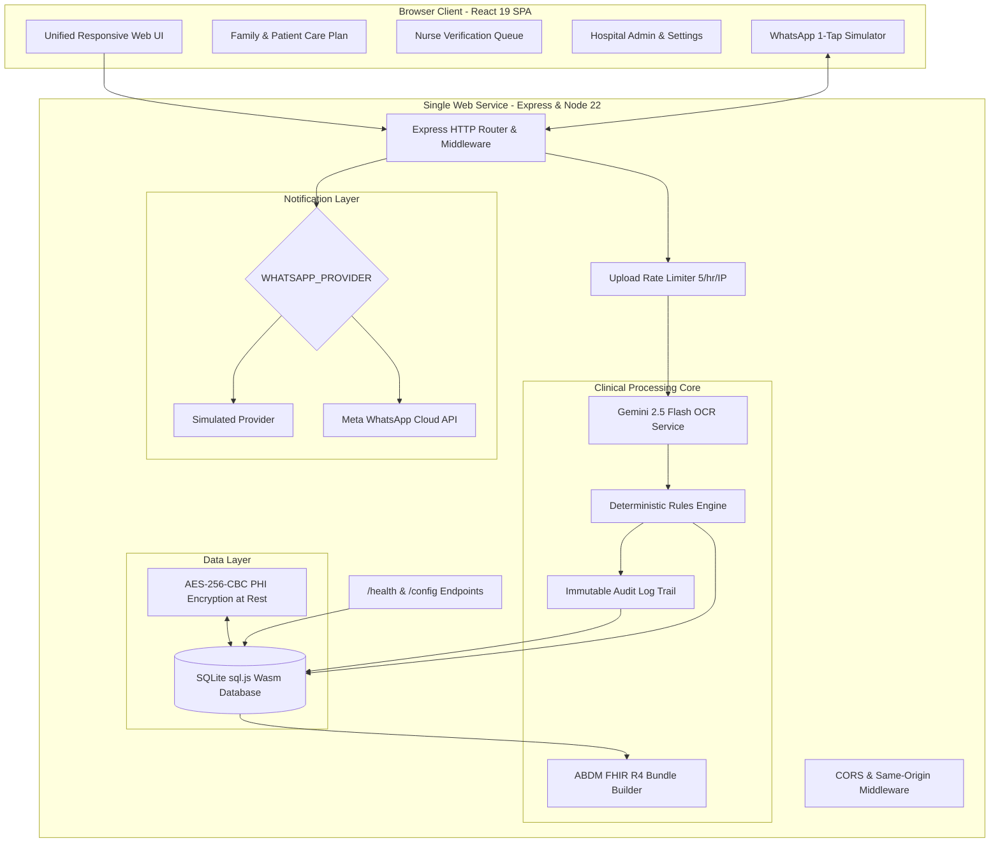

# Going Home Right

> **A safe, multilingual post-discharge care portal connecting Indian families with verified daily medicine schedules, deterministic clinical safety gates, and zero-app WhatsApp reminders.**

---

## 1. The Problem

Every day across India, over 100,000 patients are discharged from hospitals with a printed or handwritten paper summary. These documents are crowded with Latin abbreviations (`OD`, `BD`, `TDS`, `QID`, `HS`, `SOS`), illegible handwriting, and vague instructions like *"Review after 1 week"* or *"SOS if breathless"*.

For patients and their families—especially elderly individuals, caregivers with limited health literacy, and non-English speakers:
- **Medication Confusion**: Once-a-day medications (`OD`) lack specified time-of-day indications (morning vs. bedtime), leading to dangerous timing mistakes.
- **Lost Follow-ups**: Relative timelines like *"after 10 days"* are easily forgotten without a concrete calendar date.
- **Unaddressed Red Flags**: Warning signs lack actionable emergency steps, leaving families uncertain when to rush to the hospital.
- **App Fatigue**: Patients rarely download dedicated healthcare apps after leaving the ward.

The result is medication non-adherence, preventable complications, and avoidable 30-day hospital readmissions.

---

## 2. Our Solution & Key Features

**Going Home Right (Team HealthNova)** transforms confusing discharge sheets into simple, verified daily care routines delivered directly to the family's fingertips.

- **Unified Web Service**: Frontend single-page application and backend API running together on a single server and single URL.
- **Multimodal AI OCR Ingestion**: Reads printed and scanned discharge sheets via server-side Google Gemini 2.5 Flash Vision.
- **Deterministic Clinical Rules Engine**: Evaluates every extracted medicine, date, and warning against strict medical validation rules.
- **Nurse Verification Gate**: Nurses review flagged ambiguities in a dedicated queue, add clinical instructions, and issue patient access IDs.
- **Indian Meal & Solar Schedule**: Replaces confusing medical shorthand with intuitive daily blocks: **Subah (सुबह / Morning)**, **Dopahar (दोपहर / Afternoon)**, and **Raat (रात / Bedtime)**.
- **28 Indian Languages**: Translates all medicine instructions, dietary guidelines, and warning signs into 22 Eighth Schedule languages and 5 Rajasthani varieties (including Marwari, Dhundhari, and Mewati).
- **Zero-App WhatsApp Reminders**: Sends scheduled WhatsApp dose notifications without requiring the patient to download any app.
- **1-Tap Interactive Confirmation**: Patients reply with **`1`** on WhatsApp to log adherence directly back into the hospital database.
- **ABDM FHIR R4 Specification**: Generates Ayushman Bharat Digital Mission (ABDM) compliant FHIR discharge bundles with downloadable JSON.
- **Zero-Password Demo Mode**: Evaluators can instantly switch between Family, Nurse, and Hospital Admin views with 1 click.

---

## 3. The Core Safety Principle

> **AI reads. Rules decide. Missing information is flagged, never guessed.**

Standard generative AI systems often attempt to "fill in the blanks"—for example, guessing that an `OD` blood pressure tablet should be taken in the morning. In clinical medicine, guessing can be lethal.

Going Home Right enforces an uncompromising clinical safety principle:
1. **Gemini Vision acts purely as an OCR reader**, extracting printed text verbatim with a confidence score.
2. **A deterministic TypeScript rules engine** parses frequencies (`BD` → morning + night, `TDS` → morning + afternoon + night).
3. If an instruction is missing or ambiguous (e.g., `OD` with no morning/night note, or an unknown abbreviation like `QAM`), the engine **refuses to schedule it into any slot**.
4. The item is marked with an amber **`Needs nurse check`** badge and routed to the ward nurse's queue.
5. Only a verified nurse or doctor can confirm the timing, provide food instructions, and release the item to the patient.

---

## 4. Architecture Diagram



---

## 5. Technology Stack

- **Frontend**: React 19, TypeScript, Tailwind CSS v4, Lucide React, Motion.
- **Backend**: Node.js v22 LTS, Express 4, Multer (10MB upload security filter).
- **Database**: SQLite via `sql.js` (WebAssembly with disk persistence and automatic seed on startup).
- **Security & Cryptography**: AES-256-CBC encryption of patient health info (PHI) via Node `crypto`.
- **AI Multimodal OCR**: Google Gemini 2.5 Flash (`@google/genai`).
- **Internationalization**: Custom 28-language localization router (22 Eighth Schedule + 5 Rajasthani varieties).
- **Packaging & Deployment**: Multi-stage Dockerfile (`node:22-alpine`), Google Cloud Run.

---

## 6. Screenshots

Refer to **[docs/screenshots.md](docs/screenshots.md)** for detailed state descriptions and reproduction guides for the 6 submission screenshots:
1. **Home & Upload Ingestion Screen**: Dropzone and the 3 synthetic sample discharge cards.
2. **Clinical Review Screen**: Metoprolol (green *Clear*) vs. Ecosprin (amber *Needs nurse check*).
3. **My Plan with Subah / Dopahar / Raat**: Indian meal timing blocks and follow-up card.
4. **Nurse Sign-off Queue & Audit Trail**: Sister Priya Sharma approving flagged items.
5. **Patient WhatsApp Reception Sheet**: Multilingual pre-composed chat sheet and PBX fallback.
6. **Analytics & Language Picker in Marwari**: System safety metrics translated to मारवाड़ी.

---

## 7. How to Run Locally

### Prerequisites
- **Node.js**: v20+ or v22 LTS installed.
- **npm**: v10+ installed.

### 1. Clone & Install
```bash
git clone https://github.com/YOUR_GITHUB_USERNAME/going-home-right.git
cd going-home-right
npm install
```

### 2. Configure Environment Variables
Copy `.env.example` to `.env`:
```bash
cp .env.example .env
```
Edit `.env` as needed:
```env
PORT=3000
DEMO_MODE=true
WHATSAPP_PROVIDER=simulated
GEMINI_API_KEY=YOUR_GEMINI_API_KEY_HERE
DATABASE_PATH=./server/data/app.db
ENCRYPTION_KEY=ghr_healthnova_secret_encryption_key_32bytes_len!
ALLOWED_ORIGINS=
APP_URL=http://localhost:3000
```
*(Note: `GEMINI_API_KEY` is optional for evaluating the 3 built-in synthetic samples. If omitted, the deterministic synthetic parser handles samples seamlessly).*

### 3. Run in Development Mode
```bash
npm run dev
```
Open [http://localhost:3000](http://localhost:3000) in your browser.

### 4. Run Automated Tests
```bash
# Run rules engine unit tests (10/10 test suite)
npm test

# Run full end-to-end verification suite
npm run test:all
```

### 5. Build & Run Production Bundle
```bash
npm run build
NODE_ENV=production PORT=8080 node server.ts
```
Open [http://localhost:8080](http://localhost:8080).

---

## 8. Libraries Used

| Library | Version | Purpose in Application |
|---|---|---|
| `react` & `react-dom` | `^19.0.1` | Reactive user interface and modular component tree. |
| `express` | `^4.21.2` | HTTP backend server, REST endpoints, and unified static SPA hosting. |
| `@google/genai` | `^2.4.0` | Official Google GenAI TypeScript SDK for server-side Gemini 2.5 Flash Vision. |
| `sql.js` | `^1.14.2` | SQLite compiled to WebAssembly for reliable, zero-config relational SQL storage. |
| `@tailwindcss/vite` | `^4.3.3` | High-performance styling with native Vite integration. |
| `lucide-react` | `^0.546.0` | Accessible clinical icons (pills, stethoscopes, warnings, phone, checkmarks). |
| `multer` | `^2.4.0` | Multipart form parser with memory storage, 10MB limit, and MIME verification. |
| `motion` | `^12.23.24` | Smooth transitions between tabs, modal drawers, and approval badges. |
| `dotenv` | `^17.2.3` | Environment variable management. |
| `tsx` | `^4.21.0` | TypeScript execution runtime for server development and testing. |

---

## 9. Datasets & Synthetic Patient Data Disclosure

> **Strict Privacy Statement**:
> **Zero real patient data is used anywhere in this project.**
> All patient names, phone numbers, hospital names, and discharge summaries are 100% synthetic clinical scenarios created specifically by our team for safety testing and demonstration.

### How the Samples Were Created:
- **Sample 1 (`AIIMS New Delhi Cardio-Care`)**: Synthetic scenario representing a 58-year-old post-angioplasty patient (Sita Devi). Designed deliberately to test the safety rules engine: Tab Metoprolol is prescribed `BD` (clear), but Tab Ecosprin is prescribed `OD` with no time-of-day stated, triggering an intentional safety flag.
- **Sample 2 (`Max Super Speciality Hospital`)**: Synthetic scenario representing acute gastritis (Pantop `OD Subah`, Amoxicillin `BD`, Paracetamol `TDS`). Designed to demonstrate a 100% clear sheet with complete meal timings.
- **Sample 3 (`Metro Community Clinic`)**: Synthetic handwritten scenario containing ambiguous abbreviations (`QAM`, `QOD`, and an unspecified `SOS` for chest heaviness). Designed to test the nurse queue triage for non-standard clinical abbreviations.

---

## 10. Links & Submission Markers

- **Live Public Web App**: <!-- TODO: Paste your live Cloud Run deployment URL here (e.g. https://going-home-right-xxxxxx.a.run.app) -->
- **3-Minute Demo Video**: <!-- TODO: Paste your YouTube / Loom video link here -->
- **GitHub Repository**: <!-- TODO: Paste your public GitHub repository URL here -->

---

## 11. Team HealthNova

<!-- TODO: Update team members and roles below -->
- **Lead Full-Stack & Clinical Safety Engineer**: <!-- TODO: Your Name (Role / Email) -->
- **AI & Systems Engineer**: <!-- TODO: Teammate Name (Role / Email) -->
- **Product & Medical Workflow Specialist**: <!-- TODO: Teammate Name (Role / Email) -->

---

## 12. Limitations & Honest Clinical Disclaimers

1. **Prototype Software**: *Going Home Right* is an engineering prototype and technology demonstrator built for evaluation. It is **not** a certified medical device under SaMD (Software as a Medical Device) regulations.
2. **Doctor-Patient Relationship**: This application does not diagnose illnesses, prescribe medications, or alter dosages. It derives daily routines strictly from printed physician summaries and advises patients to consult their treating doctor for any clinical queries.
3. **Simulated WhatsApp Default**: Out-of-the-box deployments default to `WHATSAPP_PROVIDER=simulated` for zero-cost, reliable demonstrations without Meta Business Account verification fees. Live Meta Cloud API dispatch requires setting `WHATSAPP_PROVIDER=cloud` and supplying Meta credentials.
4. **Machine Translation Review**: While English and Hindi dictionaries have been reviewed, regional Indian language strings (including Rajasthani varieties) are machine-translated prototypes and require medical linguistic validation before clinical deployment.
5. **Container Ephemeral Storage**: On serverless container hosts like Google Cloud Run, container filesystems are temporary. Seed data resets automatically on cold restart.

---

## 13. License

This project is licensed under the **MIT License**.

```
Copyright (c) 2026 Team HealthNova

Permission is hereby granted, free of charge, to any person obtaining a copy
of this software and associated documentation files (the "Software"), to deal
in the Software without restriction, including without limitation the rights
to use, copy, modify, merge, publish, distribute, sublicense, and/or sell
copies of the Software, and to permit persons to whom the Software is
furnished to do so, subject to the following conditions:

The above copyright notice and this permission notice shall be included in all
copies or substantial portions of the Software.
```
